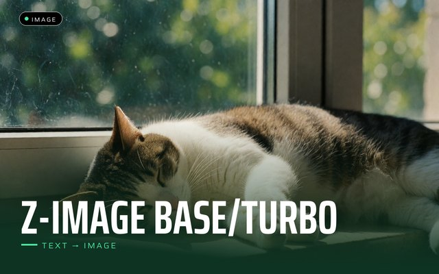
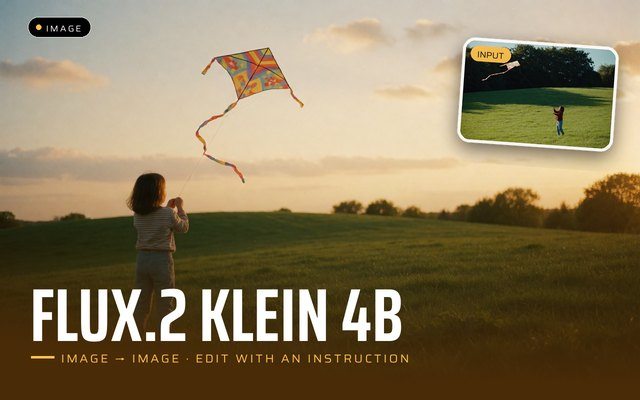
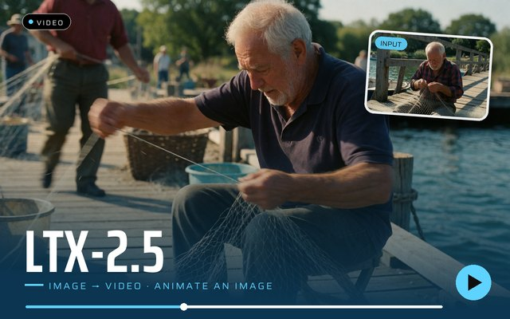
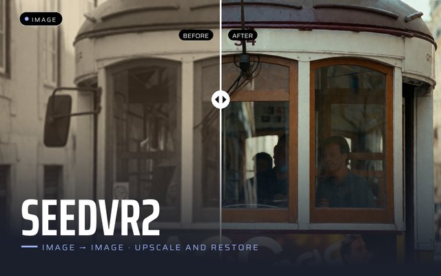

<h3 align="center">AI images, videos, music and voices on your own PC. No prompts to learn, no nodes to connect.</h3>

  <a href="https://github.com/Stefanobeck/vidlamp/releases"><b>Download for Windows</b></a> ·
  <a href="https://www.youtube.com/@tutorial3d">Tutorials</a> ·
  <a href="https://www.patreon.com/c/stefanobeck">Patreon</a>

  
  
  
  

## What is Vidlamp

Vidlamp is a free app that sits on top of [ComfyUI](https://www.comfy.org/download) and turns it into a simple studio.
Each job is a **tool** with a clear name ("Animate an image", "Edit an image with an instruction", "Upscale and
restore") and a short form: you give a photo, write what you want, press **Create**. Vidlamp builds the workflow,
runs it in your ComfyUI and puts the result in your gallery.

Everything runs on your computer. Your photos, videos and prompts stay there.

## What you can do

| | |
|---|---|
| **Images** | Create from text, edit with an instruction, change the angle of a photo, swap a head, upscale and restore old or small pictures |
| **Videos** | Video from text, animate a photo, first and last frame, continue a video, make a photo move like a video, improve the face, upscale |
| **Audio** | Voices from text, songs and instrumental music, sound for a silent video |

And around the tools:

- **It installs the models for you.** Pick a tool, press Install: Vidlamp downloads the right files into your ComfyUI
  and runs a quick test, so you know it works before you start.
- **Light versions for 8 GB video cards.** A switch shows the tools made for smaller cards.
- **Auto prompt.** Write your idea in your own language: Vidlamp rewrites it the way each model wants it (optional,
  with a local text model).
- **Batch.** Queue many jobs and let the PC work while you do something else.
- **Honest licenses.** Every tool shows whether the model behind it can be used for paid work.
- **18 languages**: English, Italiano, Deutsch, Español, Français, Português, Polski, Русский, Українська, Türkçe,
  日本語, 한국어, 简体中文, 繁體中文, हिन्दी, Bahasa Indonesia, ไทย, Tiếng Việt.

## Install

1. **Install ComfyUI** if you do not have it: [comfy.org/download](https://www.comfy.org/download). Vidlamp uses your
   ComfyUI and does not replace it.
2. **Download Vidlamp** from the [Releases](https://github.com/Stefanobeck/vidlamp/releases) page (the `.zip` file of
   the latest version).
3. **Unzip the folder** where you like, best on a fast SSD. Nothing else to install: Vidlamp brings its own Python.
4. **Double-click `Vidlamp.exe`.**
   Windows may show "Windows protected your PC", because the app is not digitally signed: click
   **More info → Run anyway**.
5. **Follow the first-start guide.** Vidlamp looks for your ComfyUI by itself, then offers a first set of tools to
   install.
6. **Open a tool and press Create.**

The very first start can take a minute while Windows checks the new files.

### What you need

- Windows 10 or 11
- An NVIDIA graphics card: 12 GB of video memory for all the tools, 8 GB for the light versions
- 16 GB of RAM or more (32 GB is more comfortable for video)
- About 50 GB free on a fast SSD (NVMe) to start; every tool you add downloads its models

### Updates

When it starts, Vidlamp checks this page and tells you if a new version is ready.

## Free and Pro

Vidlamp is **free**, also for paid work, and most tools are free. A few extra **Pro tools** are for
[Patreon](https://www.patreon.com/c/stefanobeck) members, who also support the tutorials and the work on the app.

The AI models are made by other people and companies, and each has its own license: Vidlamp shows it next to every
tool. Respecting those licenses is up to you.

## Learn

Step-by-step tutorials on [youtube.com/@tutorial3d](https://www.youtube.com/@tutorial3d).

---

<b>🇮🇹 Italiano</b>

### Cos'è Vidlamp

Vidlamp è un'app gratuita che si appoggia a [ComfyUI](https://www.comfy.org/download) e lo trasforma in uno studio
semplice. Ogni lavoro è un **tool** con un nome chiaro ("Anima un'immagine", "Modifica un'immagine con un'istruzione",
"Ingrandisci e restaura") e una scheda corta: dai una foto, scrivi cosa vuoi, premi **Crea**. Vidlamp costruisce il
workflow, lo fa girare nel tuo ComfyUI e mette il risultato nella tua galleria.

Tutto gira sul tuo computer. Foto, video e prompt restano lì.

### Cosa puoi fare

- **Immagini**: crearle dal testo, modificarle con un'istruzione, cambiare l'angolo di una foto, scambiare una testa,
  ingrandire e restaurare foto vecchie o piccole.
- **Video**: video dal testo, animare una foto, primo e ultimo fotogramma, continuare un video, far muovere una foto
  come in un video, migliorare il viso, ingrandire.
- **Audio**: voci dal testo, canzoni e musica strumentale, suono per un video muto.

E intorno ai tool: installa i modelli al posto tuo e li prova, versioni leggere per schede video da 8 GB, Auto prompt
(scrivi l'idea nella tua lingua), Batch per mettere in coda tanti lavori, licenza di ogni modello sempre in vista,
18 lingue.

### Installazione

1. **Installa ComfyUI** se non lo hai: [comfy.org/download](https://www.comfy.org/download). Vidlamp usa il tuo
   ComfyUI, non lo sostituisce.
2. **Scarica Vidlamp** dalla pagina [Releases](https://github.com/Stefanobeck/vidlamp/releases) (il file `.zip`
   dell'ultima versione).
3. **Scompatta la cartella** dove vuoi, meglio su un SSD veloce. Non serve installare altro: Vidlamp porta il suo
   Python.
4. **Doppio clic su `Vidlamp.exe`.**
   Windows può mostrare "Windows ha protetto il PC", perché l'app non ha la firma digitale: **Ulteriori informazioni →
   Esegui comunque**.
5. **Segui la guida del primo avvio.** Vidlamp cerca da solo il tuo ComfyUI, poi ti propone un primo gruppo di tool da
   installare.
6. **Apri un tool e premi Crea.**

Il primissimo avvio può richiedere un minuto mentre Windows controlla i file nuovi.

**Cosa serve:** Windows 10 o 11; scheda video NVIDIA con 12 GB di memoria video per tutti i tool, 8 GB per le versioni
leggere; 16 GB di RAM o più (32 GB è più comodo per i video); circa 50 GB liberi su un SSD veloce per iniziare.

**Aggiornamenti:** all'avvio Vidlamp controlla questa pagina e ti avvisa quando c'è una versione nuova.

### Gratis e Pro

Vidlamp è **gratis**, anche per lavori pagati, e la maggior parte dei tool è gratis. Qualche **tool Pro** in più è per
gli iscritti [Patreon](https://www.patreon.com/c/stefanobeck), che sostengono anche i tutorial e il lavoro sull'app.

I modelli di IA sono di altre persone e aziende, ognuno con la sua licenza: Vidlamp la mostra accanto a ogni tool.
Rispettarla spetta a te.

Tutorial passo per passo su [youtube.com/@tutorial3d](https://www.youtube.com/@tutorial3d).

